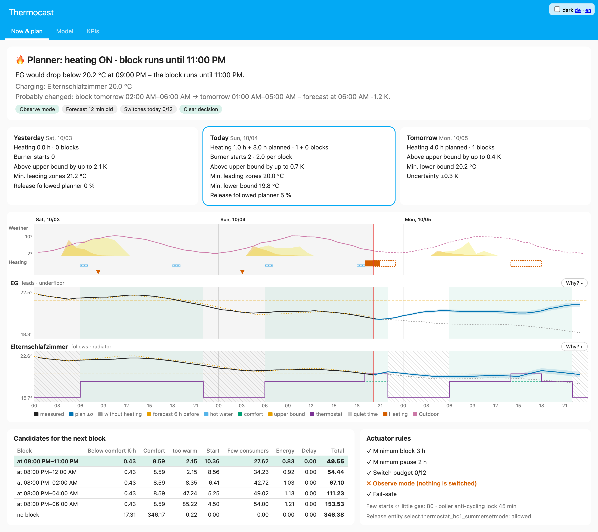

<p align="center">
  <picture>
    <source media="(prefers-color-scheme: dark)" srcset="custom_components/thermocast/brand/dark_logo@2x.png">
    
  </picture>
</p>

# Thermocast

**Deutsch** · [English](README.md)

Vorausschauende Heizfreigabe für Home Assistant – mit **online lernenden Raummodellen**,
**Einstrahlung pro Fenster-/Dachfläche** (Open-Meteo) und einem **Blockplaner**, der
überdimensionierte Kessel lange und selten statt kurz und oft laufen lässt.
Ausgelegt für Fußbodenheizung (träger Estrich) + Heizkörper, später Wärmepumpe.

> Status: v0.9 – 289 Tests (synthetisches Testhaus + HA); seit Oktober 2026 im Betrieb an einer echten Anlage
> (Gas-Brennwertkessel, Buderus RC310 über EMS-ESP, Fußbodenheizung + Heizkörper mit Better Thermostat).
> Noch jung – Feedback und Issues willkommen.
> **Startet im Beobachtungsmodus** und schaltet nichts, bis du `Steuerung aktiv` einschaltest.



## Wie es funktioniert

```
alle 15 min:  Sensoren lesen ──► Stunde abgeschlossen? ──► RLS-Update pro Zone (online, kein Neutraining)
              Open-Meteo (stündlich, je Flächenausrichtung) ──► 24-h-Simulation ohne Heizung
              Planer: kein Block | Start 0..23 h × Länge 2..12 h ──► Kosten (Komfort, zu warm, Starts je Tag,
                      Energie, wenig Abnehmer)
              Aktor: Mindestblock, Mindestpause, Tagesbudget, Taktsperre, Fail-safe ──► Freigabe-Entität
              optional je Zone: Better-Thermostat-Sollwert (Laden im Block, Untergrenze, Ruhezeit, Fenster)
```

**Modell pro Zone** (stündlich, linear in den Parametern):

```
ΔT = b0 + a·(T_außen − T) + Σ b_s,l · I_s[t−l] + Σ c_k · Q[t−k] + Σ d_n · (T_n − T) + Σ e_g · G_g
```

| Term | Bedeutung | Verzögerungen |
|---|---|---|
| `I_s` Fenster | Einstrahlung auf die Fensterfläche | 0–1 h |
| `I_s` Dach | Einstrahlung auf die Dachfläche (wirkt durch Dämmung verzögert) | 1–6 h |
| `Q` FBH | Heiz-Proxy (Vorlauf − Raum, solange die Heizungspumpe läuft), zeitgewichtet über Zustandswechsel | 0–6 h (Estrich) |
| `Q` Heizkörper | Proxy × Ventilanteil (Thermostat-`hvac_action`) | 0–1 h |
| `T_n` | Nachbarräume | – |
| `G_g` | innere Gewinne (W-Sensoren, Anwesenheit), gelernt relativ zum bisher größten Wert | – |

**Online-Lernen:** Recursive Least Squares mit Vergessensfaktor (Standard 0,996/h ≈ 10 Tage
Gedächtnis), Vorzeichen-Projektion (Sonne/Heizen/Verluste ≥ 0), Huber-Clipping gegen Ausreißer,
Kovarianz-Deckel gegen „Wind-up“ im Sommer. Stunden mit offenem Fenster oder Datenlücken werden
nicht gelernt. Der Planer rechnet mit `Mittelwert − z·σ` → unsicheres Modell heizt eher. In der Prognose klingt
ein innerer Gewinn vom aktuellen Wert zu seinem typischen Wert dieser Tagesstunde ab (Zeitkonstante 3 h, Profil aus
dem 14-Tage-Stundenlog) – ein Entfeuchter, der gerade läuft, läuft nicht drei Tage lang weiter.

**Heiz-Proxy:** `Q` wird über alle Zustandswechsel von Vorlauf, Pumpe, Warmwasser und Raumfühler innerhalb der
Stunde gemittelt, nicht aus vier Stichproben – bei taktendem Brenner lagen die um bis zu 75 % daneben.
Warmwasser-Ladungen zählen nicht als Raumheizung (Option), der **Frostschutz** des Reglers auch nicht: Unter seiner
Frostgrenze lässt das RC310 die Pumpe bei ausgeschaltetem Brenner laufen; solange die Freigabe sicher aus ist und der
Vorlauf unter 28 °C bleibt, gelten solche Stunden nicht als Heizen.

**Wetter:** Jede Open-Meteo-Abfrage fragt zwei Wettermodelle – `best_match` (in Deutschland ICON des DWD) und
ECMWF IFS. Die Außentemperatur ist ihr Mittel, **verschoben auf deinen Außenfühler**: Ein Fühler an der Wand misst
wärmer als die 2-m-Lufttemperatur der Modelle (oft 1–2 K, mittags mehr), und die Zonenmodelle haben mit dem Fühler
gelernt. Der Versatz wird je Tagesstunde gelernt (etwa die letzte Woche; beim Einrichten aus der Recorder-Historie).
Wo die Modelle auseinanderliegen, wächst das σ der Prognose – für die Außentemperatur und für die Sonne je Fläche
(über die gelernten Koeffizienten, über die Stunden aufsummiert). Der Tab *Modell* zeigt Versatz und Abstand.

**Warum kein Reinforcement Learning?** Ein Haus liefert ein paar hundert Entscheidungen pro
Saison; RL bräuchte Größenordnungen mehr und müsste dafür „ausprobieren“ (= frieren).
Modellbasiert + online identifiziert ist die dateneffiziente, sichere Variante.

## Installation

**HACS (empfohlen):** HACS → ⋮ → *Benutzerdefinierte Repositories* → `https://github.com/drumtorben/thermocast`,
Typ *Integration* → „Thermocast“ herunterladen → HA neu starten.
**Manuell:** `custom_components/thermocast` nach `config/custom_components/` kopieren, HA neu starten.
Voraussetzung: Home Assistant ≥ 2026.9. Schritt für Schritt: [`docs/INSTALLATION-CHECKLISTE.md`](docs/INSTALLATION-CHECKLISTE.md).

1. *Einstellungen → Geräte & Dienste → Integration hinzufügen → Thermocast*
2. Haus: Außentemperatur, Vorlauf, „Heizungspumpe läuft“ (empfohlen!), Freigabe-Entität.
3. Zonen über **„Zone hinzufügen“** am Integrationseintrag anlegen.

### Freigabe-Entität – Empfehlung für Buderus RC310 via EMS-ESP

| Variante | Entität | Wert „erlaubt“ | Wert „gesperrt“ | Verhalten bei HA-Ausfall |
|---|---|---|---|---|
| **A (empfohlen)** | Sommer-/Winter-Modus (`select`), Schwelle fest 10 °C | `Winter` | `Auto` | heizt weiter bzw. spätestens unter 10 °C (gedämpft) |
| B | Sommer-/Winter-Schwelle (`number`) | `16` | `10` | wie A, aber ein Block heizt nur unter 16 °C draußen; im Winterbetrieb taktet die Pumpe |
| C | Sommer-/Winter-Modus (`select`) | `Winter` | `Sommer` | bleibt gesperrt, bis HA wieder läuft – nur mit Absicherung außerhalb von HA |

Variante A „degradiert sanft“ und sorgt dafür, dass ein geplanter Block auch an milden Tagen wirklich heizt.
Schreibzugriffe sind begrenzt (Wechsel ≤ 12/Tag, Schreibvorgänge ≤ 40/Tag mit Bestätigung und Backoff),
identische Werte werden nicht erneut geschrieben (EEPROM).

### Laden & Zehren: wenige lange Brennerläufe

Ein überdimensionierter Kessel taktet, wenn er öfter kurz anspringt. Thermocast plant deshalb wenige lange
Blöcke: während eines Blocks dürfen die Zonen bis zu ihrer **Obergrenze** warm werden (Standard Komfort + 1 K),
danach zehren sie von der gespeicherten Wärme bis zur Untergrenze (in der Komfortzeit Komfort − Band, sonst der
**Grundwert**, Standard Komfort − 2 K). Der Regler **„Wenige Brennerstarts ↔ wenig Gas“** (Optionen, Standard 80)
gewichtet Starts gegen Blockstunden – beide pro Tag gerechnet, ab jetzt bis zum nächsten Wärmebedarf: Eine längere
Ladung, die eine lange Pause ermöglicht, lohnt sich, und ein Block läuft so spät wie möglich (früh gespeicherte Wärme
geht bis zum Bedarf teils verloren). Wie viel Wärme eine Blockstunde bringt, lernt Thermocast nur aus echten
Blockstunden (Pumpe lief fast die ganze Stunde). Stunden, in denen die Thermostat-Räume zu sind (an ihrer Grenze oder in der Ruhezeit),
zählen als zusätzliche Starts – Blöcke landen bevorzugt dort, wo viele Räume gleichzeitig Wärme abnehmen.
Optional setzt Thermocast je Zone den Sollwert von **Better Thermostat** (im Block die Obergrenze, sonst die
Untergrenze), mit **Ruhezeiten** (fest und/oder `schedule`-Helfer) ohne Stellgeräusche und Respekt vor Handeingriffen.

- **Laden nur bei Bedarf:** Eine Thermostat-Zone lädt im Block nur dann bis zur Obergrenze, wenn sie sonst in den
  nächsten 24 h unter ihre Untergrenze fiele, und nur in der Komfortzeit oder im **Vorladen**-Vorlauf davor (Option,
  Standard 12 h) – nicht in den letzten 3 h der Komfortzeit. Sonst hält sie ihre Untergrenze. Ist das Ziel erreicht,
  schließt das Ventil innerhalb der Stunde (der Plan rechnet die Stunde anteilig).
- **Ruhezeit:** 15 min vor Beginn schaltet Thermocast Better Thermostat **aus** (ein Sollwert allein hielt den
  Ventilmotor nicht still). Nur ein Raum mehr als 1 K unter seinem Grundwert wird in der Ruhezeit geheizt.
  Zonen-Option **Ventil in der Ruhezeit offen bei Bedarf**: einmal vor jeder Ruhezeit entschieden – fiele der Raum darin
  unter seine Untergrenze, geht das Thermostat stattdessen auf Maximum und das Ventil bleibt bis zum Ende ganz offen
  (Wärme, sobald ein Block läuft, keine Motorbewegung; der Planer sieht den Raum ungedeckelt). Dazwischen wird nichts geschrieben.
- **Wer zahlt für die Nacht:** Ein Raum in der Ruhezeit lässt sich nicht heizen – fällt er nachts unter seine
  Untergrenze, geht das auf den letzten Block vor der Ruhezeit, der den Raum dafür auflädt. Unterschreitungen, die
  kein Block verhindern kann (der Raum ist bis dahin zu), ziehen keinen Block nach vorn.

- **Offenes Fenster** (Fenster-Entitäten der Zone): die Zone löst keinen Block aus, nimmt im Plan keine Wärme
  und ihr Thermostat bleibt auf dem Grundwert – gelüftet wird nicht gegen die Heizung. Lüften kühlt die Luft,
  nicht die Wände: Eine Stunde nach dem Schließen plant Thermocast ab der Temperatur vor dem Öffnen, kurzes
  Stoßlüften löst also keinen Block aus. Fensterwechsel werden live verfolgt (auch Lüften zwischen zwei Updates);
  weder das Lüften noch die Stunde danach wird gelernt.
- **Neues oder zurückgesetztes Zonenmodell** (Zone neu, Flächen/Sensoren geändert): Die Freigabe bleibt, wie sie
  war, bis das Modell aus der Recorder-Historie gelernt hat (wenige Sekunden nach dem Neuladen).
- **Taktsperre** (Option, mit Sensor *Brennerstarts*): Würde der Kessel nach seiner Sperrzeit nur noch wenige
  Minuten vor Blockende neu starten, endet der Block kurz davor – ein Start gespart.
- **Mindestblock** begrenzt nur, wann ein laufender Block frühestens enden darf; geplant werden Blöcke ab 2 h.
- **Heizkurve prüfen:** Ein Block heizt nur, wenn der Regler genug Vorlauf verlangt. Mit einer witterungsgeführten
  Kurve liegt der Soll-Vorlauf an milden Tagen oft kaum über der Raumtemperatur – dann zündet der Brenner im Block
  gar nicht. Abhilfe: Fußpunkt der Kurve anheben (z. B. ~30–35 °C bei +20 °C außen). Zwischen den Blöcken ist der
  Heizkreis ohnehin gesperrt, der höhere Fußpunkt wirkt also praktisch nur im Block.

### Urlaub

**Urlaub Abreise** und **Urlaub Rückkehr** (Haus-Gerät, `datetime`) setzen; der Urlaub beginnt und endet von selbst.

- **Abwesend:** keine Komfortzeit, jede Zone hält nur die **Urlaub-Untergrenze** (Standard 15 °C – sie senkt den
  Grundwert einer Zone, hebt ihn nie an); Blöcke laden nicht über sie + 1 K. Thermostate (Better Thermostat) folgen.
- **Vorlauf** (Standard 12 h): ab Rückkehr − Vorlauf gilt wieder der normale Grundwert, ab der Rückkehr der
  Komfortplan. Der Planer heizt so vor, dass der Grundwert ab Beginn des Vorlaufs hält.
- Vorlauf nach dem Wetter wählen: Fußbodenheizung schafft nur wenige Zehntel Kelvin pro Stunde. Im synthetischen
  Haus reichen 12 h bei +5 °C, bei −5 °C fehlt bei Rückkehr ~1 K – bei Kälte längerer Vorlauf oder höhere
  Untergrenze. Das Panel zeigt die Prognose für die Rückkehr.
- Fail-safes, Mindestblock/-pause und EEPROM-Schutz bleiben, die Modelle lernen weiter. Eine Ausnahme: Fällt im
  Urlaub die Wetterprognose aus und ist jede Zone gemessen und ≥ 2 K über ihrer Untergrenze, hält die Freigabe
  ihren Zustand, statt zu heizen.
- Warmwasser gehört nicht dazu – dafür das Urlaubsprogramm des Reglers nutzen (RC310: Urlaubsmodus).
- Abbrechen: Rückkehr auf jetzt (oder in die Vergangenheit) setzen; ein vergangener Zeitraum ist einfach inaktiv.

### Beispiel-Zonen (Flächen als YAML im Feld „Sonnenbeschienene Flächen“)

Schlafzimmer – Fenster Ost, Dachschräge Süd:
```yaml
- {kind: window, azimuth: 90, tilt: 90, name: Fenster Ost}
- {kind: roof, azimuth: 180, tilt: 40, name: Schräge Süd}
```
Kinderzimmer – Fenster Ost, Dachschräge Nord:
```yaml
- {kind: window, azimuth: 90, tilt: 90}
- {kind: roof, azimuth: 0, tilt: 40}
```
Azimut: 0 = N, 90 = O, 180 = S, 270 = W. Neigung: 90 = senkrecht. Die Größe muss nicht angegeben
werden – die wirksame Fläche × g-Wert × Verschattung lernt das Modell.

EG mit Fußbodenheizung ohne Stellantriebe: **eine Zone** (`fbh`) mit den Sensoren Wohnzimmer +
Küche, `Führt die Freigabe` = an.

## Entitäten

| Entität | Bedeutung |
|---|---|
| `switch.…_steuerung_aktiv` | aus = Beobachtungsmodus (Standard), Freigabe bleibt „erlaubt“ |
| `binary_sensor.…_heizfreigabe` | Entscheidung des Planers (auch im Beobachtungsmodus) |
| `sensor.…_nachster_heizblock` | Start des nächsten Blocks laut Rollout (Attribut: Ende, Prognose-Alter, Fail-safe-Grund) |
| `datetime.…_urlaub_abreise/_ruckkehr`, `number.…_urlaub_*` | Urlaubszeitraum, Untergrenze, Vorlauf |
| `binary_sensor.…_urlaub` | Urlaub aktiv (Attribut `phase`: `away`/`preheat`) |
| `sensor.<zone>_prognose_minimum` | tiefste erwartete Temperatur (untere Grenze) ohne Heizen, Attribut `forecast` = Verlauf |
| `binary_sensor.<zone>_heizbedarf` | Zone fällt ohne Heizen unter ihr Komfortband |
| `sensor.<zone>_modellfehler` | laufender MAE (K/h), Attribute: Parameter, Sonnenantwort je Fläche |

## Panel „Thermocast“

Die Integration bringt ein eigenes Seitenpanel mit (Sidebar → *Thermocast*), das beantwortet:
**Warum heizt Thermocast gerade (nicht) – und was hat es bis morgen Abend vor?**

- **Story:** Planerwunsch bzw. Freigabe, nächster Block, Begründung in einem Satz, Robustheit
  („knapp“, „nur wegen der Sicherheitsmarge σ“), Planänderung seit der letzten Stunde (mit vermuteter Ursache),
  Hinweis, wenn eine Aktor-Regel (Mindestblock/-pause, Budget) den Planer überstimmt.
- **Gestern · Heute · Morgen:** Heizstunden, Blöcke, Minimum der führenden Zonen, Freigabe vs. Planer, Unsicherheit.
- **Zeitachse** (fest gestern 00:00 → morgen 24:00): Wetter (gemessen/Prognose, Sonne je Fläche),
  gelaufene und geplante Blöcke, Ereignisse (Fenster offen, Fail-safe, Prognosefehler, Steuerung an/aus …),
  je Zone gemessen / Plan ± σ / ohne Heizen / Komfortfenster. **„Warum?“** zerlegt jede künftige Stunde
  exakt in Sonne je Fläche, Heizen, Verlust, Nachbarn, Gewinne (das Modell ist linear). Fadenkreuz-Tooltip über alle Bahnen.
- **Kandidaten** für den nächsten Block mit Kostenaufschlüsselung – Hover zeichnet den Verlauf in die Zeitachse –
  und **Aktor-Regeln**.

Tab **„Modell“** (je Zone): Wie gut beschreibt das Modell die Zone?
- **Modellfehler (Hindcast):** das aktuelle Modell simuliert die letzten 7 Tage mit den *gemessenen* Eingängen
  (Neustart jede Mitternacht) – reiner Modellfehler, unabhängig von Wetterprognose und Plan.
- **Prognosegüte je Horizont** (1/3/6/12/24 h): MAE, Bias und Kalibrierung (Anteil der Messungen innerhalb ±σ;
  ≈ 68 % wäre richtig kalibriert – deutlich weniger heißt: die Sicherheitsmarge ist zu knapp).
- **Gelernte Parameter** physikalisch gelesen: Zeitkonstante τ (h), Sonne je Fläche (K/h je kW/m²),
  Heizen (K/h im typischen Block), Nachbarkopplung, Gewinne, Grunddrift – mit ±1σ und 30-Tage-Verlauf;
  Estrich-Verzögerungsprofil. **JSON-Export** aller Modellzustände und Logs (z. B. für polars).

Tab **„KPIs“** (14/30/90 Tage, aus den Recorder-Langzeitstatistiken): Brennerstarts/Tag, kWh pro Heizgradtag
(Gerade kWh/Tag über Heizgradtagen, Heizgrenze 16 °C), Minimum der führenden Zonen in Komfortzeit, Unterschreitungsstunden – jeweils
**vor** und **seit** dem ersten Einschalten der Steuerung. Dafür in den Optionen der Integration
**Brennerstarts** und **Heizenergie** (beide `total_increasing`, z. B. von EMS-ESP) eintragen; optional
**Warmwasser aktiv** für die Schraffur in der Zeitachse.

Der Plan bis morgen entsteht durch einen **Rollout des echten Reglers**: stündlich neu planen, Mindestblock,
Mindestpause und Tagesbudget anwenden, Zustand fortschreiben. Im Beobachtungsmodus führt ein Schatten-Aktor
die Regeln virtuell mit. Die Vergangenheit kommt aus dem Recorder; ohne Recorder bleibt sie leer.
Das Panel ist reine Ansicht und läuft getrennt vom Regelpfad – ein Fehler dort ändert nie die Freigabe.

### ApexCharts-Karte (Prognose vs. Komfort)

```yaml
type: custom:apexcharts-card
graph_span: 24h
span: {start: hour}
header: {show: true, title: Schlafzimmer – Prognose ohne Heizen}
series:
  - entity: sensor.schlafzimmer_prognose_minimum
    name: Erwartet
    data_generator: |
      return entity.attributes.forecast.map(p => [new Date(p.time).getTime(), p.mean]);
  - entity: sensor.schlafzimmer_prognose_minimum
    name: Untere Grenze
    data_generator: |
      return entity.attributes.forecast.map(p => [new Date(p.time).getTime(), p.lower]);
  - entity: sensor.schlafzimmer_prognose_minimum
    name: Komfort
    data_generator: |
      return entity.attributes.forecast.map(p => [new Date(p.time).getTime(), p.comfort_low]);
```

## Sicherheit

* Beobachtungsmodus ist Standard.
* Einschalten der Heizung ist immer erlaubt; Ausschalten nur nach Mindestblock und im Tagesbudget.
  Will der Planer den nächsten Block vor Ende der Mindestpause, bleibt die Heizung an (keine 2-h-Sperre).
* Fehler im Update, Prognose älter als 2 h, fehlender Sensor einer führenden Zone → Freigabe **an**.
  Dauert ein Fail-safe länger als 1 h, erscheint ein Reparaturhinweis.
* Entladen/Entfernen der Integration oder Ausschalten der Steuerung → Freigabe **an**
  (ein Neuladen nach einer Konfigurationsänderung nicht). Nach einem HA-Start warten fehlende Sensoren/Prognose
  bis zu 5 min, bevor der Fail-safe greift (MQTT/Zigbee kommen oft verzögert).
* **EEPROM-Schutz:** Jeder Schreibvorgang muss von der Entität bestätigt werden. Unbestätigt → neuer Versuch
  erst nach 10 min, dann mit wachsender Pause (30 min … 6 h), Ereignis + Reparaturhinweis. Nie mehr als
  **40 Schreibvorgänge pro Tag**; bei nicht verfügbarer Entität wird gar nicht geschrieben.

## Lernen, Kalibrierung, Diagnose

* **Warmstart:** Neue Zonen lernen beim Einrichten aus den letzten **30 Tagen** Recorder-Langzeitstatistik
  (+ Einstrahlung aus Open-Meteo-Vergangenheitsdaten) statt mit Standardwerten zu starten. Der Button
  *„Modelle aus Historie neu lernen“* wiederholt das für alle Zonen (und lernt den Außenfühler-Versatz neu).
* **σ-Kalibrierung** (Option, Standard an): Aus den beobachteten Prognosefehlern der letzten 14 Tage wird je
  Horizont ein Faktor gelernt, um den der Planer die Unsicherheit weitet (nie verengt). Sichtbar im Modell-Tab („σ ד).
* **Komfort-Zeitplan:** Je Zone optional ein Zeitplan-Helfer (`schedule.*`), z. B. Büro werktags 8–17 Uhr.
* **Diagnose herunterladen** (⋮ an der Integration): alle Modelle, Logs, Ereignisse, Aktorzustand.
* Installation in einer echten HA: siehe [`docs/INSTALLATION-CHECKLISTE.md`](docs/INSTALLATION-CHECKLISTE.md).

## Entwicklung

```
custom_components/thermocast/
├── core/            reines Python + numpy (Notebook- & Test-tauglich, kein HA-Import)
│   ├── model.py     OnlineZoneModel (RLS), Ursachen-Zerlegung
│   ├── forecast.py  Open-Meteo, Einstrahlung je Ausrichtung
│   ├── planner.py   Blockplaner, Ober-/Untergrenze, Lade-Deckel, Kostenfunktion „Laden & Zehren“
│   ├── bt.py        Better-Thermostat-Sollwert (rein): Laden, Untergrenze, Ruhezeit
│   ├── rules.py     Aktor-Regeln (rein)
│   ├── rollout.py   Regler-Rollout bis morgen 24:00
│   ├── explain.py   Begründungs-Codes, Robustheit, Planänderung
│   ├── series.py    Stundenaggregation von Zustandsfolgen
│   └── view.py      Panel-View-Vertrag v1
├── coordinator.py   Sensoren → Stunden-Samples → Modell → Planer → Aktor
├── actuator.py      Freigabe schalten (Mindestzeiten, Budget, Fail-safe)
├── zone_actuator.py Better-Thermostat-Sollwerte je Zone (opt-in, Handeingriffe, Ruhezeiten)
├── view_builder.py  Panel-Daten (Historie, Rollout, Ereignisse) – getrennt vom Regelpfad
├── history.py, events.py, websocket_api.py, panel.py
├── frontend/        Panel (Lit, ohne Build): thermocast-panel.js, tc-*.js, i18n.js, dev/
└── config_flow.py   Haus, Zonen (Subentries), Optionen
```

```bash
uv sync                        # .venv mit Home Assistant + pytest-homeassistant-custom-component
uv run pytest                  # Kern- und HA-Tests
uv run pytest tests/test_core.py   # nur Kern, ohne HA
./scripts/develop              # lokale HA-Instanz mit Fake-Sensoren → http://localhost:8123
```

Die Dev-Instanz (`config/configuration.yaml`) bringt Schieberegler für Außen-, Vorlauf- und
Raumtemperaturen, einen Heizungspumpen-Schalter und `input_number.summer_threshold` als Freigabe.

Panel-Entwicklung ohne HA:

```bash
uv run python scripts/sample_view.py      # Beispiel-Antworten (View, Modell, KPIs) aus synthetischen Daten
uv run python -m http.server -d custom_components/thermocast/frontend 8765
# → http://localhost:8765/dev/   (?tab=now|model|kpis, ?lang=en, ?dark=1, ?hover=50, ?cand=1, ?why=1, ?src=<datei.json>)
```

Im Notebook: `sys.path.insert(0, "custom_components/thermocast")`, dann `from core import OnlineZoneModel`.

## Roadmap

- [x] HA-Tests mit `pytest-homeassistant-custom-component` (Config Flow, Coordinator)
- [x] Panel „Gestern · Heute · Morgen“ (Begründung, Plan, Ursachen, Kandidaten)
- [x] Panel B: Modellgüte (Hindcast, Prognosehorizonte, Kalibrierung, Parameter, JSON-Export, WW-Ladungen)
- [x] Panel C: KPIs (Brennerstarts/Tag, kWh pro Heizgradtag, Komfort, vorher/nachher)
- [x] Warmstart aus der Recorder-Historie beim Einrichten (statt Prior)
- [x] Zonen-Komfort und Ruhezeiten aus `schedule`-Helfern
- [x] Diagnostics-Download, Repairs (Fail-safe, EEPROM-Schreibschutz)
- [x] „Laden & Zehren“: Ober-/Untergrenze, Zehrzeit, Better-Thermostat-Steuerung, Ruhezeiten
- [x] Blöcke bevorzugt bei vielen offenen Abnehmern; fensterbewusst; Blockende passend zur Taktsperre
- [x] Innere Gewinne nach Tagesprofil prognostizieren (aktueller Wert klingt zum typischen ab)
- [x] Zwei Wettermodelle, Prognose auf den Außenfühler korrigiert, Wetter-σ aus ihrem Abstand
- [x] Urlaubsmodus (abgesenkte Untergrenze, Vorlauf vor der Rückkehr)
- [x] Thermostat-Zonen laden nur bei Bedarf; der Block vor einer Ruhezeit zahlt für die Nacht
- [ ] Hausstrom als Gewinn-Signal; Gewinn-Profil je Wochentag
- [ ] Nachbartemperaturen über den Horizont prognostizieren (heute konstant)
- [ ] Anwesenheit (`zone.home`) im Komfort
- [ ] Zwei-Zustands-Modell (Luft + Speichermasse) bzw. geglättetes Sonnensignal
- [ ] Kurvenanhebung während eines Blocks (Estrich gezielt laden)
- [ ] Rollladen-Zustand als Verschattungsfaktor
- [ ] Kostenfunktion Wärmepumpe: COP(T_außen, Vorlauf), EPEX-Preis, PV-Überschuss
